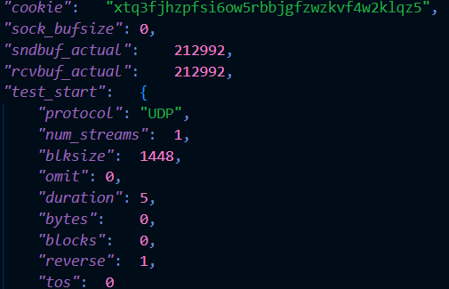
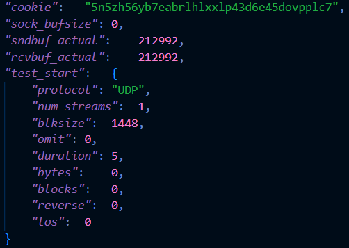
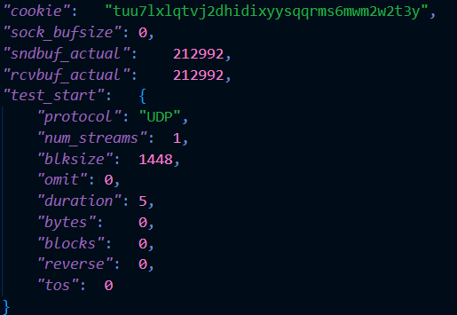
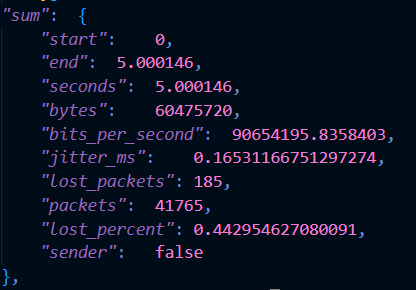
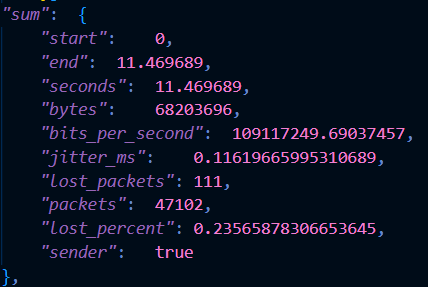
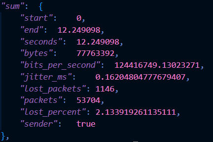
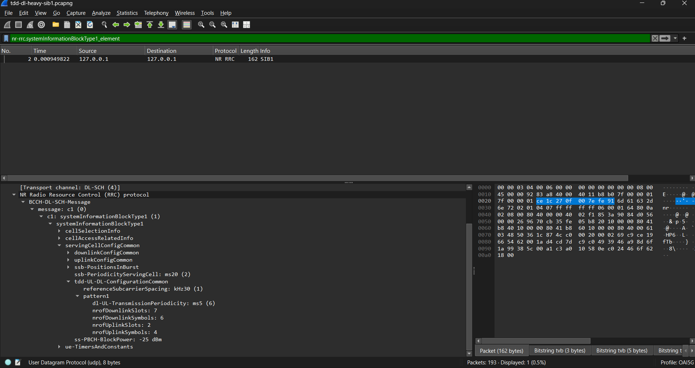
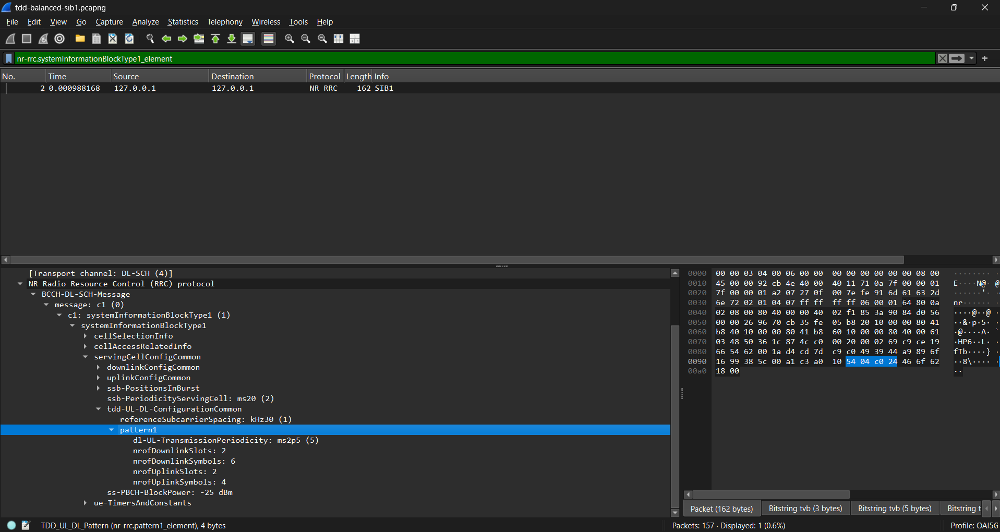
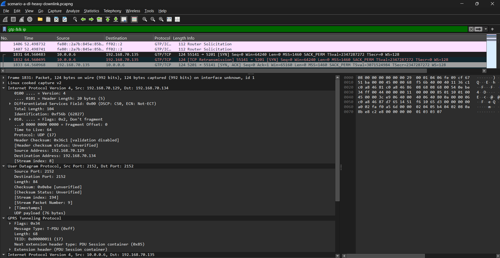
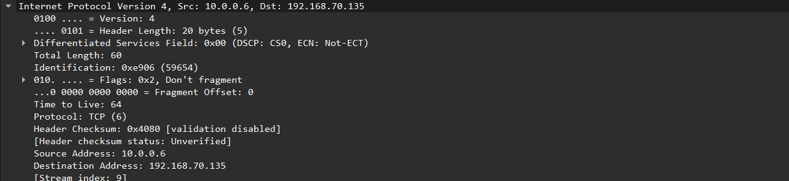

# Wireless Communications Lab2
###### tags: `Wireless Communications`

## :notebook_with_decorative_cover: Lab 2: gNB TDD Traffic Analysis

## 1. Lab Overview

After completing this lab, you should be able to:

- analyze how 5G TDD slot allocation affects uplink and downlink performance
- read the TDD configuration from SIB1
- interpret the DL/UL time allocation
- analyze iperf3 throughput, packet loss, and jitter
- relate the observed network performance to the configured TDD pattern

## 2. Test scenarios and files

Two types of packet captures are provided in this lab:

- Configuration captures: Recorded separately during initial cell access to show the broadcast SIB1 messages for the two TDD settings. Use these files to read and draw the common TDD configuration. Only two configuration captures are required because Scenarios A and B share the DL-heavy setting.
- Scenario captures: Recorded during the iperf3 tests. Use these files to analyze user-plane packets and the TCP control connection. Separate captures are provided for A, B, and C because each scenario uses a different combination of TDD setting and traffic direction.
The configuration captures are reference recordings for the corresponding settings, not simultaneous recordings of the original iperf3 runs. The scenario-to-configuration mapping below is supplied by the instructor; it cannot be established from the iperf3 JSON alone. Configuration captures are not used to calculate test throughput, loss, jitter, RTT, or packet intervals.

## 3. Task 1 — Confirm the Traffic Direction

Used json files: 

- scenario-a-downlink.json
- scenario-b-uplink.json
- scenario-c-uplink.json

| Scenario | Reverse value | Direction |
|---|---:|---|
| A | `1` | Downlink |
| B | `0` | Uplink |
| C | `0` | Uplink |

The traffic direction shown in the JSON match the scenario description.

- Scenario A has `"reverse": 1`, which means downlink.
- Scenario B has `"reverse": 0`, which means uplink.
- Scenario C has `"reverse": 0`, which means uplink.

## 4. Task 2 — Compare Throughput

Conversion of the values:

`Throughput (Mbps) = bits_per_second ÷ 1,000,000`

| Scenario | Direction | Throughput(Mbps) |
|---|---|---:|
| A | Downlink | 90.65 |
| B | Uplink | 109.12 |
| C | Uplink | 124.42 |

### Questions

1. The downlink throguhput in Scenario A is approximately **90.65 Mbps**.
2. The uplink throughput in Scenario B is approximately **109.12 Mbps**.
3. The uplink throughput is higher in **Scenario C**.
4. Imporovement from B to C:
   `(124.42 - 109.12) / 109.12 × 100 ≈ 14.02%`

   Therefore, Scenario C improves uplink throughput by approximately **14.02%** compared with Scenario B.

## 5. Task 3 — Check the Trade-off

| Scenario | Throughput(Mbps) | Packet loss (%) | Jitter(ms) |
|---|---:|---:|---:|
| B | 109.12 | 0.236 | 0.116 |
| C | 124.42 | 2.134 | 0.162 |

### Questions

1. Yes. Scenario C has higher uplink throughput than Scenario B.
2. No. Scenario C has higher packet loss than Scenario B. Packet loss increases from approximately **0.236%** to **2.134%**.
3. Compared with Scenario B, Scenario C has higher throughput, higher packet loss and higher jitter. This suggests the balanced TDD configuration makes better uplink throughput, but makes an increased packet loss and jitter.

## 6. Task 4 — Read SIB1 and Draw the TDD Configuration

4.2 Enable MAC-NR Decoding and Find SIB1

4.3 Record the TDD Parameters

| Item | DL-heavy: A/B | Balanced: C |
|---|---|---|
| Configuration capture filename | `tdd-dl-heavy-sib1.pcapng` | `tdd-balanced-sib1.pcapng` |
| SIB1 packet number | 2 | 2 |
| `referenceSubcarrierSpacing` (kHz) | 30 kHz | 30 kHz |
| `dl-UL-TransmissionPeriodicity` (ms) | 5 ms | 2.5 ms |
| `nrofDownlinkSlots` | 7 | 2 |
| `nrofDownlinkSymbols` | 6 | 6 |
| `nrofUplinkSlots` | 2 | 2 |
| `nrofUplinkSymbols` | 4 | 4 |
| `pattern2` present? | - | - |

4.4 Draw the TDD Time Allocation

| TDD setting | Repeating duration (ms) | Total reference slots | DL symbols | UL symbols | Flexible symbols | Configured UL symbol share (%) |
|---|---:|---:|---:|---:|---:|---:|
| DL-heavy | 5 | 10 | 104 | 32 | 4 | 22.86% |
| Balanced | 2.5 | 5 | 34 | 32 | 4 | 45.71% |

| TDD setting | Repeating duration (ms) | Repetitions in 5 ms | DL symbols in 5 ms | UL symbols in 5 ms | Flexible symbols in 5 ms |
|---|---:|---:|---:|---:|---:|
| DL-heavy | 5 | 1 | 104 | 32 | 4 |
| Balanced | 2.5 | 2 | 68 | 64 | 8 |

### Question: Can two patterns have the same UL symbol count per period but provide different numbers of UL symbols per unit time? Explain using your two tables.
Yes. Two TDD patterns can have the same number of UL symbols per repeating period but still provide different numbers of UL symbols per unit time.

Both configurations have 32 configured UL symbols per period. However, the DL-heavy pattern repeats every 5 ms, while the Balanced pattern repeats every 2.5 ms. Therefore, over the same 5 ms interval, the DL-heavy configuration provides 32 UL symbols while the Balanced configuration provides 64 UL symbols.

4.5 Connect SIB1 to the Performance Results

| Scenario | Reference TDD setting | JSON traffic direction | Configured UL symbol share (%) | Throughput (Mbps) | Packet loss (%) |
|---|---|---|---:|---:|---:|
| A | DL-heavy | Downlink | 22.86% | 90.65 | 0.443% |
| B | DL-heavy | Uplink | 22.86% | 109.12 | 0.236% |
| C | Balanced | Uplink | 45.71% | 124.42 | 2.134% |

### Guestions:

#### 1. Which decoded TDD parameters differ between DL-heavy and Balanced?

The main differences are the `dl-UL-TransmissionPeriodicity` and `nrofDownlinkSlots`.

The DL-heavy configuration has a period of **5 ms** and **7 full downlink slots**, while the Balanced configuration has a period of **2.5 ms** and **2 full downlink slots**.

The other decoded values are the same. Both configurations use **30 kHz** reference subcarrier spacing, **6 downlink symbols**, **2 uplink slots**, and **4 uplink symbols**.

#### 2. Which configuration provides more configured UL symbols per unit time?

The **Balanced configuration** provides more configured UL symbols per unit time.

Both configurations contain **32 UL symbols per repeating period**, but the Balanced pattern repeats every **2.5 ms**, while the DL-heavy pattern repeats every **5 ms**.

Therefore, over the same 5 ms interval:

- DL-heavy provides **32 UL symbols**.
- Balanced provides **64 UL symbols**.

The configured UL symbol share is approximately **22.86%** for DL-heavy and **45.71%** for Balanced.

#### 3. How does that difference help explain the B/C throughput comparison?

Scenario B uses the DL-heavy configuration and achieves approximately **109.12 Mbps** uplink throughput.

Scenario C uses the Balanced configuration and achieves approximately **124.42 Mbps** uplink throughput.

The Balanced configuration provides more uplink transmission opportunities because it has a higher configured UL symbol share and twice as many configured UL symbols over the same 5 ms interval. This helps explain why Scenario C achieves higher uplink throughput than Scenario B.

However, the TDD configuration is not necessarily the only reason for the throughput difference. Scheduling, radio conditions, protocol overhead, and other factors can also affect performance.

#### 4. Why can A and B use the same SIB1 TDD configuration even though their traffic directions differ?

Scenarios A and B can use the same SIB1 TDD configuration because the TDD pattern is a **cell configuration broadcast by the gNB**, while the traffic direction is determined by the iperf3 test.

## 7. Task 5 — Is the TDD Setting Suitable?

| Scenario | TDD setting | Traffic direction | Is the setting suitable for this direction? Why? |
|---|---|---|---|
| A | DL-heavy | Downlink | Yes. The DL-heavy configuration provides more downlink transmission opportunities, so it is suitable for downlink traffic. |
| B | DL-heavy | Uplink | Less suitable. The DL-heavy configuration provides fewer uplink transmission opportunities, which can limit heavy uplink traffic. |
| C | Balanced | Uplink | Yes, and it is more suitable for uplink traffic than Scenario B because it provides more configured UL resources. |

### Question: Why might Scenario C achieve better uplink throughput than Scenario B?

Scenario C uses the Balanced TDD configuration, while Scenario B uses the DL-heavy configuration.

From the SIB1 analysis, the Balanced configuration has a configured UL symbol share of **45.71%**, while the DL-heavy configuration has only **22.86%**.

Over the same 5 ms interval:

- Scenario B's DL-heavy configuration provides **32 UL symbols**.
- Scenario C's Balanced configuration provides **64 UL symbols**.

Because Scenario C has more configured uplink transmission opportunities, the UE can send uplink data more frequently. This helps explain why Scenario C achieved approximately **124.42 Mbps** uplink throughput compared with approximately **109.12 Mbps** in Scenario B.

However, the additional UL resources do not guarantee better performance in every metric. In this test, Scenario C also had higher packet loss and slightly higher jitter than Scenario B.

## 8. Task 6 — Find GTP-U Information

## 8. Task 6 — Find GTP-U Information

| Item | Value |
|---|---|
| Scenario capture filename | `scenario-a-dl-heavy-downlink.pcapng` |
| Packet number | 1831 |
| Outer source IP | `192.168.70.129` |
| Outer destination IP | `192.168.70.134` |
| Inner source IP | `10.0.0.6` |
| Inner destination IP | `192.168.70.135` |
| TEID | `0x00000011` (17) |

### Explanation

The outer IP addresses, `192.168.70.129` and `192.168.70.134`, identify the endpoints of the GTP-U tunnel.

The inner IP addresses, `10.0.0.6` and `192.168.70.135`, belong to the original user/application packet carried inside the tunnel.

The TEID is `0x00000011` (17). It identifies the GTP-U tunnel at the receiving endpoint.

