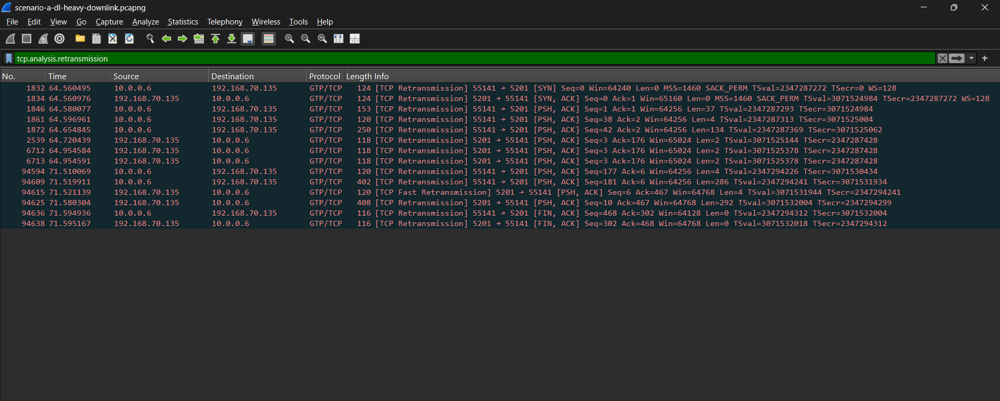
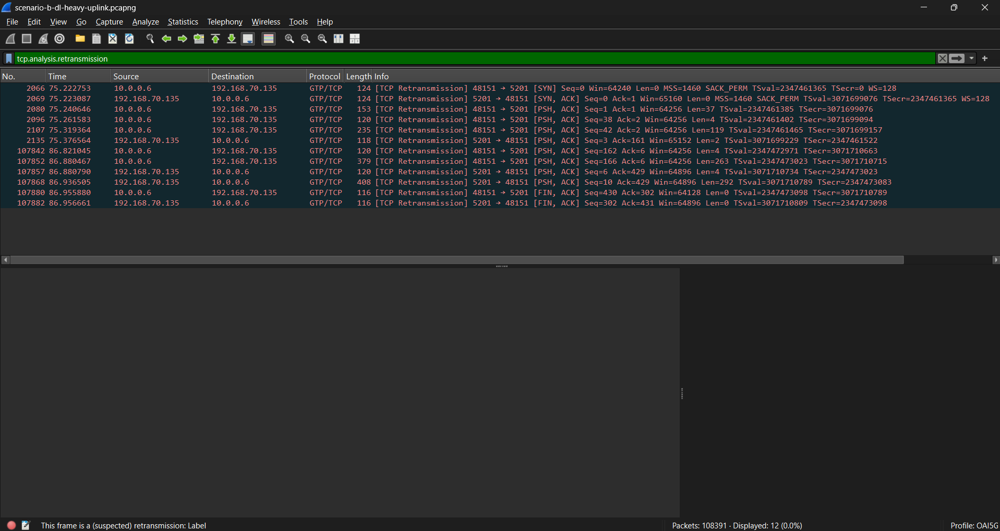
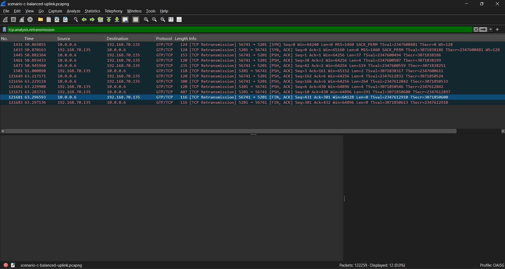
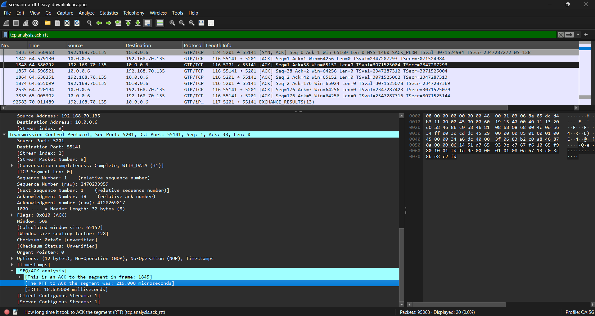
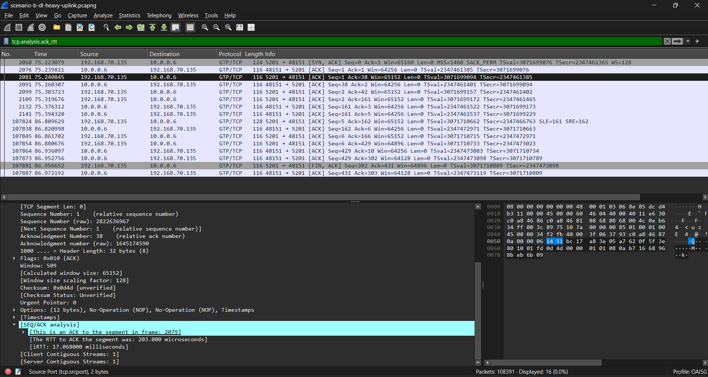
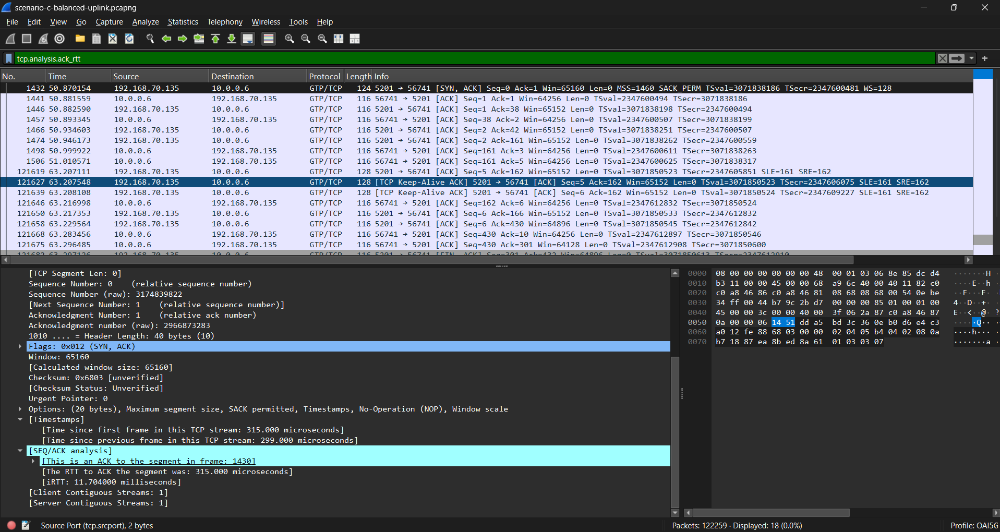
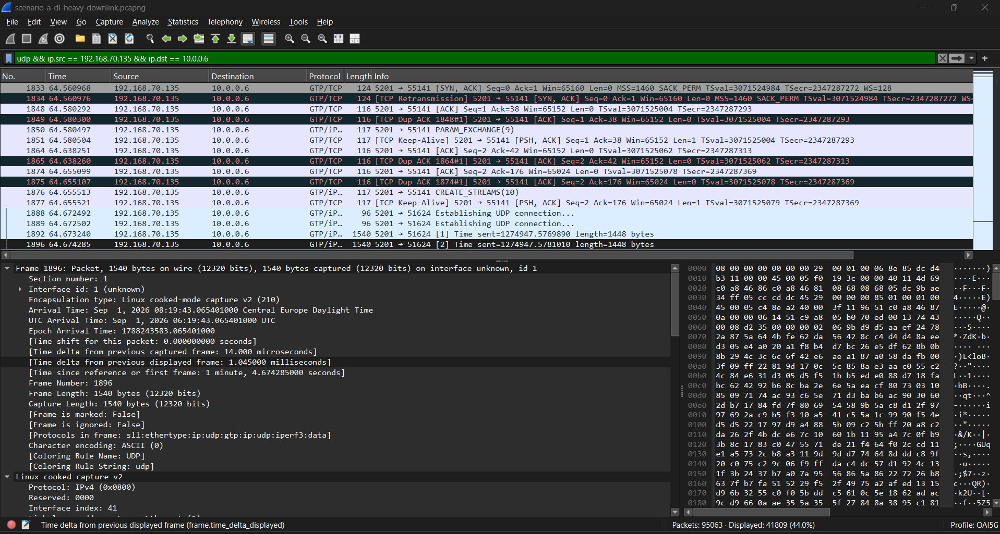

# Wireless Communications Lab2
###### tags: `Wireless Communications`

## :notebook_with_decorative_cover: Lab 2: gNB TDD Traffic Analysis

## 1. Lab Overview

After completing this lab, you should be able to:

- analyze how 5G TDD slot allocation affects uplink and downlink performance
- read the TDD configuration from SIB1
- interpret the DL/UL time allocation
- analyze iperf3 throughput, packet loss, and jitter
- relate the observed network performance to the configured TDD pattern

## 2. Test scenarios and files

Two types of packet captures are provided in this lab:

- Configuration captures: Recorded separately during initial cell access to show the broadcast SIB1 messages for the two TDD settings. Use these files to read and draw the common TDD configuration. Only two configuration captures are required because Scenarios A and B share the DL-heavy setting.
- Scenario captures: Recorded during the iperf3 tests. Use these files to analyze user-plane packets and the TCP control connection. Separate captures are provided for A, B, and C because each scenario uses a different combination of TDD setting and traffic direction.
The configuration captures are reference recordings for the corresponding settings, not simultaneous recordings of the original iperf3 runs. The scenario-to-configuration mapping below is supplied by the instructor; it cannot be established from the iperf3 JSON alone. Configuration captures are not used to calculate test throughput, loss, jitter, RTT, or packet intervals.

## 3. Task 1 — Confirm the Traffic Direction

Used json files: 

- scenario-a-downlink.json
- scenario-b-uplink.json
- scenario-c-uplink.json

| Scenario | Reverse value | Direction |
|---|---:|---|
| A | `1` | Downlink |
| B | `0` | Uplink |
| C | `0` | Uplink |

The traffic direction shown in the JSON match the scenario description.

- Scenario A has reverse: 1, which is downlink.
- Scenario B has reverse: 0, which is uplink.
- Scenario C has reverse: 0, which is uplink.

 

*Figure: Scenario A*

 

*Figure: Scenario B*

 

*Figure: Scenario C*

## 4. Task 2 — Compare Throughput

Conversion of the values:

`Throughput (Mbps) = bits_per_second ÷ 1,000,000`

| Scenario | Direction | Throughput(Mbps) |
|---|---|---:|
| A | Downlink | 90.65 |
| B | Uplink | 109.12 |
| C | Uplink | 124.42 |

 

*Figure: Scenario A*

 

*Figure: Scenario B*

 

*Figure: Scenario C*

### Questions

1. What is the downlink throughput in Scenario A? 

The downlink throguhput in Scenario A is 90.65 Mbps.

2. What is the uplink throughput in Scenario B?

The uplink throughput in Scenario B is 109.12 Mbps.

3. Is the uplink throughput higher in B or C?

Uplink throughput is higher in Scenario C.

4. By approximately what percentage does C improve over B?

Imporove from B to C:

   `(124.42 - 109.12) / 109.12 × 100 = 14.02%`

   Scenario C imporoves uplink throughput at 14.02% than in Scenario B.

## 5. Task 3 — Check the Trade-off

| Scenario | Throughput(Mbps) | Packet loss (%) | Jitter(ms) |
|---|---:|---:|---:|
| B | 109.12 | 0.236 | 0.116 |
| C | 124.42 | 2.134 | 0.162 |

### Questions

1. Does C have higher uplink throughput than B? 

Yes, it does, the scenario C has higher uplink throughput than B.

2. Does C have lower packet loss than B?

No, it does not, the scenario C has higher packet loss than B. Packet loss increases from 0.236 % to 2.134 %.

3. What trade-off, if any, is visible when changing from B to C?

So the Scenario C has higher throughput, higher packet loss and higher jitter. This eans that the balanced TDD makes better uplink throughput, but makes an increased packet loss and jitter.

## 6. Task 4 — Read SIB1 and Draw the TDD Configuration

4.2 Enable MAC-NR Decoding and Find SIB1

 

*Figure: DL-heavy*

 

*Figure: Balanced*

4.3 Record the TDD Parameters

| Item | DL-heavy: A/B | Balanced: C |
|---|---|---|
| Configuration capture filename | `tdd-dl-heavy-sib1.pcapng` | `tdd-balanced-sib1.pcapng` |
| SIB1 packet number | 2 | 2 |
| `referenceSubcarrierSpacing` (kHz) | 30kHz | 30kHz |
| `dl-UL-TransmissionPeriodicity` (ms) | 5ms | 2.5ms |
| `nrofDownlinkSlots` | 7 | 2 |
| `nrofDownlinkSymbols` | 6 | 6 |
| `nrofUplinkSlots` | 2 | 2 |
| `nrofUplinkSymbols` | 4 | 4 |
| `pattern2` present? | - | - |

4.4 Draw the TDD Time Allocation

| TDD setting | Repeating duration (ms) | Total reference slots | DL symbols | UL symbols | Flexible symbols | Configured UL symbol share (%) |
|---|---:|---:|---:|---:|---:|---:|
| DL-heavy | 5 | 10 | 104 | 32 | 4 | 22.86% |
| Balanced | 2.5 | 5 | 34 | 32 | 4 | 45.71% |

| TDD setting | Repeating duration (ms) | Repetitions in 5 ms | DL symbols in 5 ms | UL symbols in 5 ms | Flexible symbols in 5 ms |
|---|---:|---:|---:|---:|---:|
| DL-heavy | 5 | 1 | 104 | 32 | 4 |
| Balanced | 2.5 | 2 | 68 | 64 | 8 |

### Question: Can two patterns have the same UL symbol count per period but provide different numbers of UL symbols per unit time? Explain using your two tables.
Yes, they can, so the two TDD patterns can have the same numbr of UL symbols in repeating period but provides different numbers of UL symbols in unit time and the both configurations have 32 configured UL symbols in the period, but the DL-heavy pattern repeats every 5 ms, while the balanced pattern repeats every 2.5 ms, so over the same 5 ms interval, the DL-heavy configuration only provides 32 UL symbols, while the Balanced configuration provides 64 UL symbols.

4.5 Connect SIB1 to the Performance Results

| Scenario | Reference TDD setting | JSON traffic direction | Configured UL symbol share (%) | Throughput (Mbps) | Packet loss (%) |
|---|---|---|---:|---:|---:|
| A | DL-heavy | Downlink | 22.86% | 90.65 | 0.443% |
| B | DL-heavy | Uplink | 22.86% | 109.12 | 0.236% |
| C | Balanced | Uplink | 45.71% | 124.42 | 2.134% |

### Guestions:

#### 1. Which decoded TDD parameters differ between DL-heavy and Balanced?

The differences are the `dl-UL-TransmissionPeriodicity` and `nrofDownlinkSlots` configurations. The DL-heavy configuration has a period of 5 ms and it has 7 full downlink slots and the balanced configuration has a period of 2.5 ms and 2 full downlink slots and the other decoded values are the same values. Both configurations use 30 kHz reference subcarrier spacing which is 6 downlink symbols, 2 uplink slots and 4 uplink symbols.

#### 2. Which configuration provides more configured UL symbols per unit time?

The balanced configuration provides more configured UL symbols per unit time. Both two configurations contains 32 UL symbols per repeating period, but the balanced configuration repeats every 2.5 ms and the DL-heavy pattern repeats every 5 ms, so balanced configuration makes more dymbols.

#### 3. How does that difference help explain the B/C throughput comparison?

The scenario B uses the DL-heavy configuration and achieves 109.12Mbps uplink throughput and the scenario C uses the balanced configuration with 124.42Mbps uplink throughput, so the Balanced configuration provides more uplink transmission opportunities because it has a higher number of configured UL symbols.

#### 4. Why can A and B use the same SIB1 TDD configuration even though their traffic directions differ?

Scenarios A and B can use the same SIB1 TDD configuration, because the TDD pattern is cell configuration broadcast and it is by the gNB and the traffic direction is determined by the iperf3, so they can have the same configuration.

## 7. Task 5 — Is the TDD Setting Suitable?

| Scenario | TDD setting | Traffic direction | Is the setting suitable for this direction? Why? |
|---|---|---|---|
| A | DL-heavy | Downlink | Yes, it is, becase the DL-heavy configuration provides more downlink transmission opportunities, so it is suitable for downlink. |
| B | DL-heavy | Uplink | It is less suitable, because the DL-heavy configuration makes fewer uplink transmission opportunities, so this can limit heavy uplink. |
| C | Balanced | Uplink | Yes, it is, it has more configured UL resources. |

### Question: Why might Scenario C achieve better uplink throughput than Scenario B?

So the scenario C uses the balanced TDD configuration and the scenario B uses the DL-heavy configuration. The balanced configuration has a configured UL symbol 45.71% and the DL-heavy configuration has 22.86%. So because the scenario C has more configured uplink transmission opportunities, the UE can send uplink data more frequently.

## 8. Task 6 — Find GTP-U Information

 

*Figure: Scenario A - DL Heavy Downlink Part 1*

 

*Figure: Scenario A - DL Heavy Downlink Part 2*

## 8. Task 6 — Find GTP-U Information

| Item | Value |
|---|---|
| Scenario capture filename | `scenario-a-dl-heavy-downlink.pcapng` |
| Packet number | 1831 |
| Outer source IP | `192.168.70.129` |
| Outer destination IP | `192.168.70.134` |
| Inner source IP | `10.0.0.6` |
| Inner destination IP | `192.168.70.135` |
| TEID | `0x00000011` (17) |

### Explanation

The outer IP addresses, `192.168.70.129` and `192.168.70.134`, identify the endpoints of the GTP-U tunnel.

The inner IP addresses, `10.0.0.6` and `192.168.70.135`, belong to the original user/application packet carried inside the tunnel.

The TEID is `0x00000011` (17). It identifies the GTP-U tunnel at the receiving endpoint.

## 9. Task 7 — TCP Retransmissions

| Scenario | Displayed TCP retransmissions |
|---|---:|
| A | 14 |
| B | 12 |
| C | 12 |

### Question: Do these TCP retransmissions directly represent lost UDP performance packets?

No. These retransmissions belong to TCP flows that Wireshark can decode, such as the iperf3 TCP control connection.

The performance traffic in this lab is UDP, so these TCP retransmissions do not directly represent lost UDP performance packets. UDP packet loss should instead be taken from the iperf3 JSON results.

 

*Figure: Scenario A - DL Heavy Downlink*

 

*Figure: Scenario B - DL Heavy Uplink*

 

*Figure: Scenario C - Balanced Uplink*

## 10. Task 8 — RTT and Packet Interval

 

*Figure: Scenario A - DL Heavy Downlink RTT*

 

*Figure: Scenario B - DL Heavy Uplink RTT*

 

*Figure: Scenario C - Balanced Uplink RTT*

### TCP RTT

| Scenario | Packet number | Example TCP ACK RTT |
|---|---:|---:|
| C | 121627 | 0.315 ms |

The selected packet shows an ACK RTT of **315 microseconds**, which is equal to **0.315 ms**.

This RTT value belongs to the iperf3 TCP control connection, not the UDP performance traffic.

### Packet Interval

Packets 1892 and 1896:

 

*Figure: Scenario A DL Heavy Downlink - Packet 1896 Interval*

### Packet Interval

| Scenario | Display filter | Packet numbers | Time interval |
|---|---|---|---|
| A | `udp && ip.src == 192.168.70.135 && ip.dst == 10.0.0.6` | 1892 → 1896 | 1.045 ms |

The packet interval was measured from packet 1896 using the Wireshark field `Time delta from previous displayed frame`.

The measured interval between the two consecutive displayed UDP data packets is **1.045 ms**.

## 11. Final Guestions

### 1. Does Scenario A use a TDD setting that matches its traffic direction?

Yes, because the ccenario A uses the DL-heavy TDD configuration and the traffic direction is downlink.

### 2. Why is Scenario B expected to have limited uplink resources?

Because the scenario B uses the DL-heavy configuration and it has only 32 UL symbols in 5 ms, so less resources are configured for uplink.

### 3. How much does uplink throughput change from B to C?

Scenario B achieves approximately **109.12 Mbps**, while Scenario C achieves approximately **124.42 Mbps**.

This is an increase of about **15.30 Mbps**, or approximately **14.02%**.

### 4. What negative result, if any, is visible in C?

Scenario C has higher packet loss and slightly higher jitter than Scenario B.

Packet loss increases from approximately **0.236%** in Scenario B to **2.134%** in Scenario C, while jitter increases from about **0.116 ms** to **0.162 ms**.

### 5. Why can increasing UL resources improve uplink throughput?

Increasing UL resources gives the UE more opportunities to transmit uplink data.

In this lab, the Balanced configuration provides **64 UL symbols in 5 ms**, compared with only **32 UL symbols** in the DL-heavy configuration, which helps support higher uplink throughput.

### 6. Is adding more UL resources always the best solution?

No. More UL resources can improve uplink throughput, but other performance metrics may become worse.

In this lab, Scenario C has higher throughput than Scenario B, but its packet loss also increases from approximately **0.236%** to **2.134%**, so there is a trade-off.

### 7. Suggest one simple follow-up test that could improve throughput without producing too much packet loss.

A simple follow-up test would be to try a TDD configuration with an UL allocation between the DL-heavy and Balanced settings.

The goal would be to provide more UL transmission opportunities than Scenario B while checking whether packet loss stays lower than the **2.134%** observed in Scenario C.

### 8. What can the configuration captures tell you that the iperf3 JSON cannot? Why are separately recorded configuration captures not direct proof of the configuration during an earlier test?

The configuration captures allow us to read the broadcast SIB1 TDD parameters, such as the transmission periodicity, number of DL and UL slots, and number of DL and UL symbols. The iperf3 JSON only reports traffic direction and performance results such as throughput, packet loss, and jitter.

The configuration captures were recorded separately from the original iperf3 tests, so they are reference captures for the supplied TDD settings. Therefore, they cannot independently prove that the exact same configuration was broadcast during an earlier performance test.

