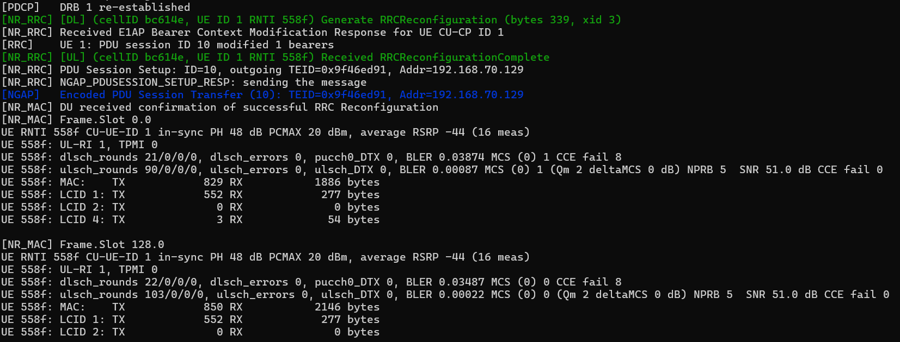
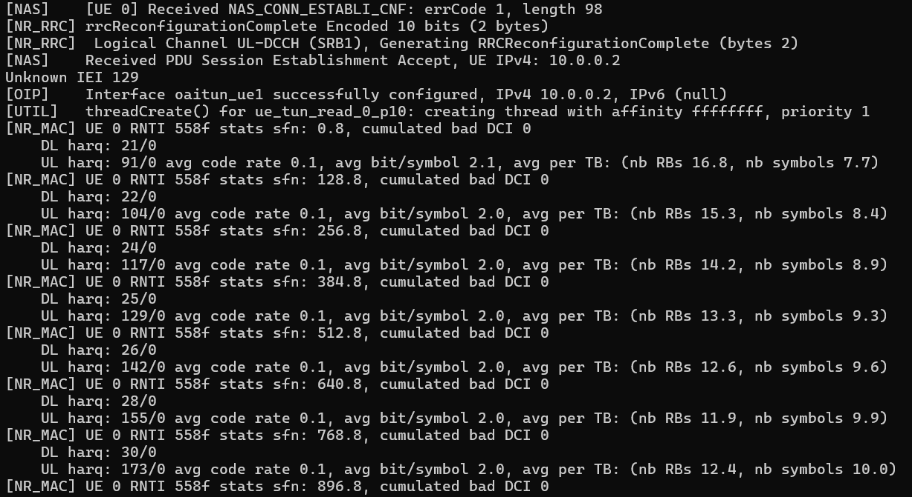
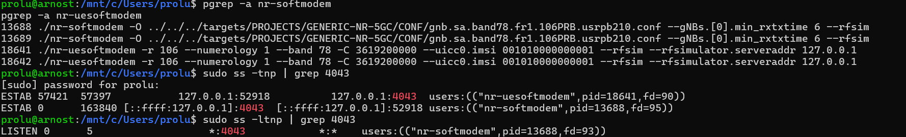
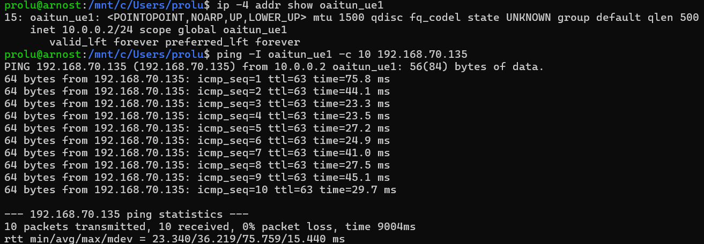
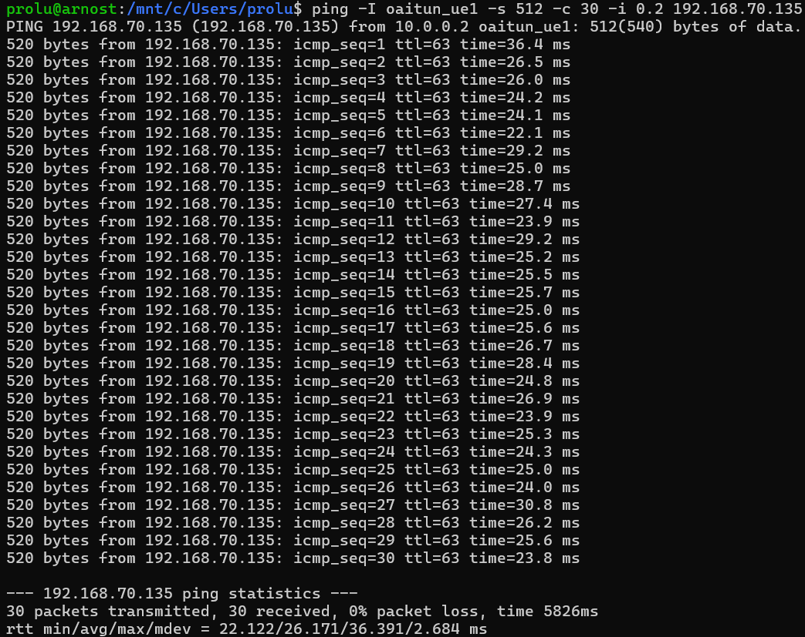
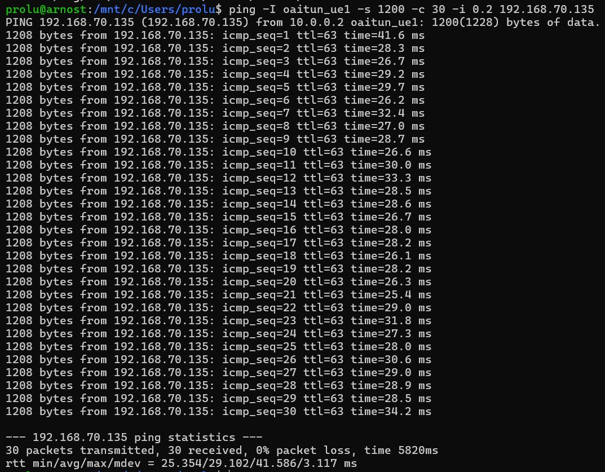
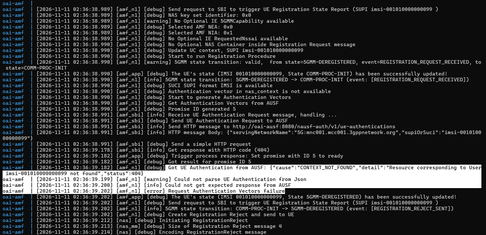
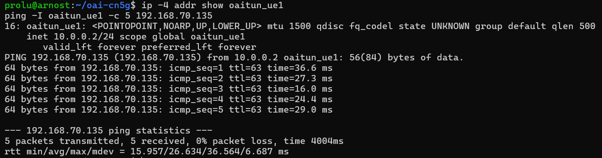

# Wireless Communications Lab3
###### tags: `Wireless Communications`

## :notebook_with_decorative_cover: Lab 3: Deploying a 5G Standalone Network Using OpenAirInterface

## 1. Lab Overview

In the previous labs, you analyzed 5G signaling messages and network performance using provided captures and measurements.

In this lab, you will deploy your own 5G Standalone (SA) network using OpenAirInterface (OAI), verify the complete connection, investigate RFsimulator communication, perform active network measurements, and troubleshoot a controlled connection failure.

Unlike the previous labs, you will collect measurements directly from your own running 5G network.

After completing this lab, you should be able to:

1. Deploy an OAI gNB, nrUE, and 5G Core Network.
2. Identify the main stages of 5G SA connection establishment.
3. Verify communication between gNB and nrUE through RFsimulator.
4. Measure user-plane connectivity under different packet sizes.
5. Diagnose connection failures using OAI and 5GC logs.
6. Explain the limitations of a software-simulated 5G network.

## 2. Experimental Environment

Use the OAI v2.4.0 Build Guide to prepare the environment before class. The experiment uses one Ubuntu machine without physical RF hardware.

## 3. Task 1 — Deploy and Verify the Complete 5G SA Network

 

*Figure: gNB successfully connected*

 

*Figure: UE successfully connected*

## Task 1 — Deploy and Verify the Complete 5G SA Network

| Stage | Successful? | Evidence from logs |
|---|---|---|
| CN5G initialization | yes | show `healthy`. |
| gNB NG Setup | yes | `Received NGSetupResponse from AMF` |
| UE synchronization | yes |  `UE synchronized!` |
| RRC connection establishment | yes | `State = NR_RRC_CONNECTED` |
| UE Registration | yes | The UE received `RegistrationComplete` |
| PDU Session Establishment | yes | `PDU Session Establishment Accept, UE IPv4: 10.0.0.2`. |
| UE tunnel creation | yes |  `Interface oaitun_ue1 successfully configured, IPv4 10.0.0.2`. |

### Questions

1. Does a successful NG Setup guarantee that a UE can register? Explain.

   No, it does not. Because the UE still has to complete synchronization, RRC connection establishment, NAS registration, security, autentification and the gNB could be connected to the AMF also when a UE registration attempt failed.

2. Why can the UE establish an RRC connection but still fail Registration?

   RRC connection establishment is being done between the UE and gNB at the radio access network level. The registration has NAS with the 5G Core. The UE is synchronize and `NR_RRC_CONNECTED`,but it does not have authentication or registration with the AMF. This happened to me when the AMF could not obtain the authentication response from AUSF in time. The AUSF sent response 1 ms later than the AMF ressponse timer was.

3. What additional procedure is required after Registration before user data can be exchanged?

   A PDU Session has to be done after successful registration. This procedure creates the user plane connectivity and cpnnects the UE an IP address.

## 4. Task 2 — Investigate RFsimulator Communication

 

*Figure: TCP connection*

| Item | Observed Value |
|---|---|
| gNB process ID | 13688 |
| nrUE process ID | 18611 |
| RFsimulator transport protocol | TCP |
| RFsimulator port | 4043 |
| TCP connection state | ESTABLISHED |
| Connected process(es) | `nr-softmodem` and `nr-uesoftmodem` |

### Questions

1. Why does RFsimulator use a TCP connection instead of a physical antenna?

   Instead of transmitting RF signals through real physical antenna, the virtual simulated radio samples are going through a virtual TCP connection. This allows the 5G radio protocol stack to be tested without physical RF hardware, because the real RF hardware is expensive.

2. Are the TCP packets exchanged by RFsimulator the same as the UE's application-layer IP packets?

   No, they are not. The RFsimulator TCP connection transport virtual simulated radio IQ sample data going to the nrUE and gNB.

3. Does using RFsimulator mean that the UE and gNB are performing no physical layer processing? Explain.

   No, it does not. The UE and gNB makes 5G NR physical layer processing: synchronization, OFDM, channel coding, modulation, scheduling.

## 5. Task 3 — Verify End-to-End Connectivity

 

*Figure: Ping result*

| Measurement | Observed Value |
|---|---:|
| UE IP address | 10.0.0.2 |
| Destination IP | 192.168.70.135 |
| Packets transmitted | 10 |
| Packets received | 10 |
| Packet loss (%) | 0% |
| Minimum RTT (ms) | 23.340 |
| Average RTT (ms) | 36.219 |
| Maximum RTT (ms) | 75.759 |

### Questions

1. Why must Ping use the `oaitun_ue1` interface in this experiment?

   Because `oaitun_ue1` interface is the UE's PDU Session and takes user plane traffic through the 5G network. Using the command `-I oaitun_ue1` tkes the ping packets to use the UE tunnel. This is to make sure that the connectivity test goes through the OAI 5G user plane.

2. Does successful Registration guarantee successful user-plane connectivity?

   No, it does not, because the registration writes that the UE has connected and authenticated with the 5G Core, but user plane communication still requires the PDU Session. The UE has to receive an IP address and the path mmust work between the gNB and UPF.

3. What does a successful Ping prove, and what does it not prove about the simulated 5G system?

   A successful Ping proves that IP packets can make it from the UE through the PDU Session to the external DN. All 10 packets were received with 0% packet loss, confirming user plane connection. It does not prove that the simulated system has the same radio performace or latency as a real 5G equpment. The real world is not ideal as the simulation is.

## 6. Task 4 — Investigate the Effect of Packet Size

 

*Figure: Scenario A — Small Packets*

 

*Figure: Scenario B — Medium Packets*

 

*Figure: Scenario C — Large Packets*

| Scenario | ICMP Payload | Avg. RTT (ms) | Max. RTT (ms) | Packet Loss (%) |
| -------- | -----------: | ------------: | ------------: | --------------: |
| A        |     56 bytes |        22.018 |        27.833 |              0% |
| B        |    512 bytes |        26.171 |        36.391 |              0% |
| C        |   1200 bytes |        29.102 |        41.586 |              0% |

### RTT Difference

RTT Difference = Average RTT(C) - Average RTT(A) = 29.102 - 22.018  = 7.084 ms

### Questions

1. Which scenario has the highest average RTT?

   Scenario C: the highest average RTT at 29.102 ms.

2. Does increasing packet size always increase RTT in your measurements?

   The average RTT increased as the ICMP payload size increased. The average RTT is 22.018 ms for 56-byte packets to 26.171 ms for 512-byte packets and then to 29.102 ms for 1200-byte packets. But also other system conditions can also affect latency so not always is the packet size increase RTT.

3. Why might a larger packet require more transmission or processing resources?

   Becasue larger packets contains more data and needs more resources to process and transport. They require more schedulings, encoding, decoding and memory.

4. What factors other than packet size could affect RTT in a software-based 5G network?

   For example the RTT can also be affected by CPU or sofware scheduling, system load, the docker container process, the load on the OAI gNB and UE processes.

5. Can these results be interpreted as real over-the-air 5G latency? Explain.

   No, they can not, because the results represent latency in an virtual OAI RFsimulator environment, but not in than a real 5G network. There are no real wireless behaviour which is interference, fading, path loss or delay.

## 7. Task 5 — Diagnose a Controlled UE Registration Failure

 

*Figure: Wrong IMSI UE*

 

*Figure: Corrected IMSI UE*

| Item | Observation |
|---|---|
| Modified parameter | IMSI changed from `001010000000001` to `001010000000099` |
| UE synchronized with gNB? | Yes |
| RRC connection established? | Yes |
| Registration successful? | No |
| Error or rejection evidence | AMF received HTTP `404` from AUSF: `CONTEXT_NOT_FOUND`: `Resource corresponding to User imsi-001010000000099 not found`. The AMF then reported `Request Authentication Vectors failure` and sent a Registration Reject. |
| Likely cause | The incorrect IMSI `001010000000099` was not provisioned in the 5G Core database. |

### Questions

1. Why can the UE potentially synchronize with the gNB even when the IMSI is incorrect?

   Because thge UE synchronization and the initial radio connection occur before the 5G Core authenticates the user identity. The IMSI is used later in NAS Registration and authentication with the 5G Core.

2. Which network function is involved in UE authentication?

   The AUSF is involved in UE authentication, because the AMF sends the UE authentication request to the AUSF and it has the needed authentication information. SO in this task the AUSF did not find authentication information for IMSI `001010000000099` so it returned a `404 CONTEXT_NOT_FOUND` and later `Resource corresponding to User imsi-001010000000099 not found`.

3. Why does changing an IMSI affect Registration but not the RFsimulator TCP connection itself?

   Because thhe RFsimulator TCP connection only gives the simulated radio samples between the nrUE and gNB. It does not authenticate the UE subscriber identity.

4. What evidence proves that restoring the correct configuration solved the problem?

   After restoring the correct IMSI `001010000000001`, the UE is registered. The interface `oaitun_ue1` was recreated with IPv4 address `10.0.0.2/24` and ping test to the External DN `192.168.70.135` was successful:

   - Packets transmitted: 5
   - Packets received: 5
   - Packet loss: 0%
   - Minimum RTT: 15.957 ms
   - Average RTT: 26.634 ms
   - Maximum RTT: 36.564 ms

## 8. Task 7 — Explain the Relationship Between Simulation and Real 5G

