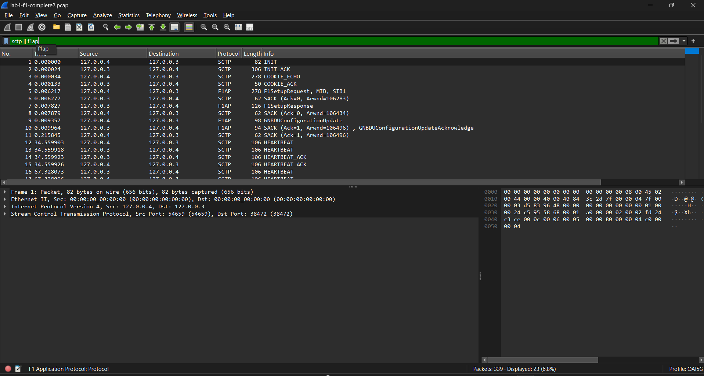
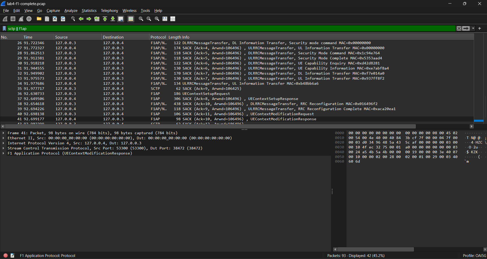
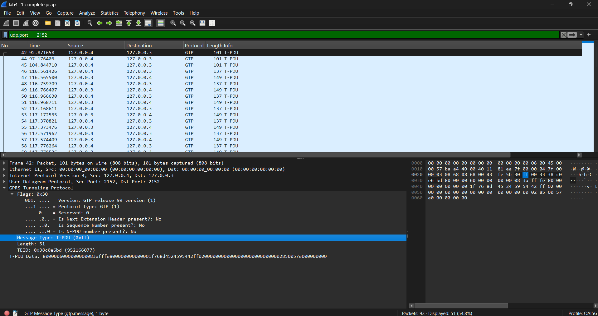
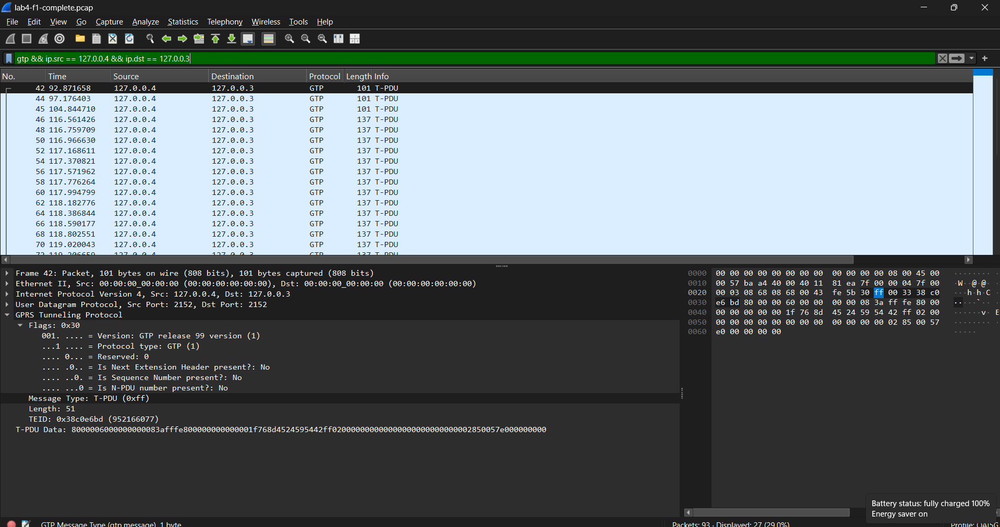
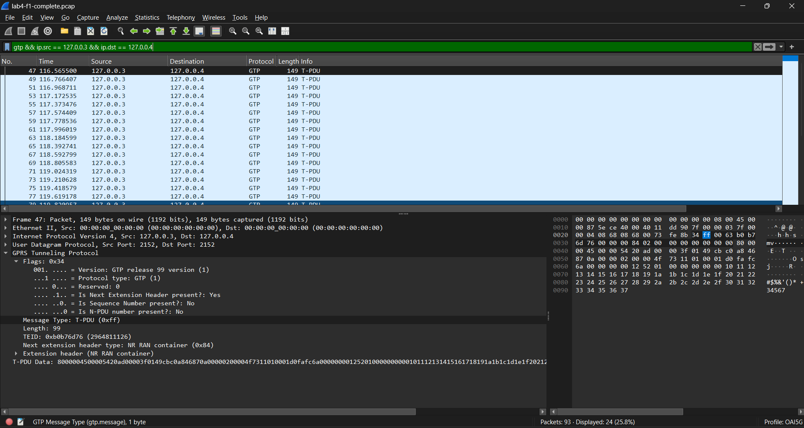

# Wireless Communications Lab4
###### tags: `Wireless Communications`

## :notebook_with_decorative_cover: Lab 4: 5G CU/DU Split Deployment and F1-C/F1-U Analysis

## 1. Lab Overview

After completing this lab, you should be able to:

- Explain the functional division between gNB-CU and gNB-DU.
- Deploy a split 5G SA RAN with OAI and RFsimulator.
- Identify F1-C control-plane messages (F1 Setup, RRC transfer, UE Context Setup).
- Identify F1-U user-plane GTP-U packets, including their direction and TEID.
- Verify UE IP connectivity through the split architecture.
- Distinguish F1-U from the separate N3 interface, even though both can use GTP-U.

## 2. Network architecture and experimental parameters

The Lab 3 monolithic gNB config used absoluteFrequencySSB = 641280 (3,619.20 MHz), whereas the split DU config used 630048 (3,450.72 MHz). The frequency parameters must match the working DU/UE pair. Do not reuse Lab 3's -C 3619200000 without checking the DU configuration. The -C argument and effective radio carrier placement should be verified against OAI startup logs; the above value is the one used in the successful classroom test, not a general formula for every DU file.

## 3. Task 1 — Inspect the split configurations

 

*Figure: Split configurations*

| Parameter | Observed Value |
|---|---|
| CU F1 address | `127.0.0.3` |
| DU F1 address | `127.0.0.4` |
| DU SSB NR-ARFCN | `630048` |
| DL absolute Frequency Point A | `628776` |
| PRB count | `106` |
| Physical Cell ID | `0` |
| `min_rxtxtime` | `4` |
| F1-U UDP port | `2152` |
| AMF address | `192.168.70.132` |

### Questions

1. Which protocol layers mainly reside in the CU, and which reside in the DU?

   The gNB-CU has the higher layer functions (RRC and PDCP). The gNB-DU hhas RLC, MAC, PHY. This split allows to process separate the higher level control functions and low level radio processing.

2. What is the purpose of the F1 interface?

   The F1 interface is connecting the gNB-CU and gNB-DU. F1-C has the control plane signal using F1AP and F1-U has the user plane traffic using GTP-U. This is allowing for the CU and DU to coooperate together.

3. Why must the UE radio frequency be compatible with the DU rather than taken blindly from the previous lab?

   The UE has to tune to the radio carrier confiigured by the DU. The DU uses `630048`, corrresponding to the split-lab frequency.

## 4. Task 2 — Split 5G SA Connectivity

| Measurement | Observed Value |
|---|---:|
| UE IP address | `10.0.0.2` |
| Destination IP | `192.168.70.135` |
| Packets transmitted | 30 |
| Packets received | 30 |
| Packet loss | 0% |
| Minimum RTT | 13.559 ms |
| Average RTT | 23.117 ms |
| Maximum RTT | 40.656 ms |

Evidence: Screenshots of CU/DU startup, UE connection, and successful Ping. Record the observed UE IP, transmitted/received packets, packet loss, and average RTT. Do not invent values; they vary by machine.

 

*Figure: CU Startup*

 

*Figure: DU Startup*

 

*Figure: UE connection*

 

*Figure: Successful ping*

## 5. Task 3 — Capture F1-C and F1-U in a single PCAP

A packet capture was performed on the Linux loopback interface between the CU address `127.0.0.3` and DU address `127.0.0.4`.

The capture has:

- F1-C: F1AP signaling carried over SCTP between the DU and CU.
- F1-U: GTP-U user-plane traffic carried over UDP between the DU and CU.

The capture file was saved as: `lab4-f1-complete.pcap`.  The capture was opened with wireshark on windows.

## 6. Task 4 — Analyze F1-C (F1AP / SCTP)

### F1 Setup Sequence

| Packet | Source | Destination | Message | Meaning |
|---:|---|---|---|---|
| 1 | `127.0.0.4` | `127.0.0.3` | SCTP INIT | DU starts the SCTP |
| 2 | `127.0.0.3` | `127.0.0.4` | SCTP INIT_ACK | CU acknowledges the SCTP request|
| 3 | `127.0.0.4` | `127.0.0.3` | SCTP COOKIE_ECHO | DU continues SCTP establish|
| 4 | `127.0.0.3` | `127.0.0.4` | SCTP COOKIE_ACK | SCTP association is establish|
| 5 | `127.0.0.4` | `127.0.0.3` | F1 Setup Request | DU initiates the F1 setup|
| 7 | `127.0.0.3` | `127.0.0.4` | F1 Setup Response | CU accepts the F1 Setup|
| 9 | `127.0.0.4` | `127.0.0.3` | GNBDUConfigurationUpdate | DU informs the CU configuration|
| 10 | `127.0.0.3` | `127.0.0.4` | GNBDUConfigurationUpdateAcknowledge | CU acknoledge the DU configuration|

### Questions

1. Which node initiates F1 Setup, and which acknowledges it?

   The gNB-DU starts the F1 Setup procedure by sending the F1 Setup Request to the gNB-CU. The packet 5 is sent from `127.0.0.4` (DU) to `127.0.0.3` (CU). The CU acknowlegdes the procedure by the F1 Setup Response.

2. Explain the difference between SCTP association establishment and F1 Setup.

   The SCTP association establishment makes the transport connection between the DU and CU. It uses the INIT, INIT_ACK, COOKIE_ECHO, COOKIE_ACK messages. F1 Setup occurs after SCTP is established.

3. How can a NAS Registration Request be transported over F1-C?

   The UE first sends the NAS Registration Request inside an RRC message toward the DU. The DU forwards the UE RRC signaling to the CU using an F1AP UL RRC Message.

4. What is the role of UE Context Setup?

   The UE Context Setup makes UE resources and context between the CU and DU. The CU sends a UE Context Request and the DU responds after creating the required UE resources.

5. Does F1 Setup alone prove successful UE Registration? Explain.

   No, it does not, because the F1 Setup only proves that the CU and DU established their internal F1 interface successfully. The UE must still synchronize, complete RRC procedures, so F1 Setup can succeed even if UE Registration later fails.

 

*Figure: F1 Setup Request/Response*

### UE-Associated F1AP Messages

| Packet | Source | Destination | Message | Meaning |
|---:|---|---|---|---|
| 36 | `127.0.0.3` | `127.0.0.4` | UE Context Setup Request | CU asks the DU to create UE-specific resources. |
| 37 | `127.0.0.4` | `127.0.0.3` | UE Context Setup Response | DU confirms that the UE context was created. |
| 38 | `127.0.0.3` | `127.0.0.4` | DL RRC Message Transfer — RRC Reconfiguration | CU forwards RRC configuration toward the UE. |
| 39 | `127.0.0.4` | `127.0.0.3` | UL RRC Message Transfer — RRC Reconfiguration Complete | UE confirms completion of the RRC reconfiguration. |

 

*Figure: F1AP messages*

## 7. Task 5 — Analyze F1-U (GTP-U / UDP)

 

*Figure: GTP-U*

| Field | Observed Value |
|---|---|
| Packet number | 42 |
| Source IP | `127.0.0.4` |
| Destination IP | `127.0.0.3` |
| UDP source port | `2152` |
| UDP destination port | `2152` |
| Protocol | GTP-U |
| Message type | `T-PDU (0xff)` |
| TEID | `0x38c0e6bd` (`952166077`) |
| Direction | DU → CU (uplink) |

 

*Figure: GTP-U uplink*

 

*Figure: GTP-U downink*

| Direction | Source | Destination | Packet Count | Example Packet | TEID |
|---|---|---|---:|---:|---|
| Uplink (DU → CU) | `127.0.0.4` | `127.0.0.3` | 27 | 42 | `0x38c0e6bd` |
| Downlink (CU → DU) | `127.0.0.3` | `127.0.0.4` | 24 | 47 | `0xb0b76d76` |

### Questions

1. Which transport protocol carries F1-U?

   The F1-U is carried using GTP-U over UDP. The source and destination UDP ports are `2152`.

2. What does a GTP-U TEID identify?

   It is an Tunnel Endpoint Identifier, which identifies a particular GTP-U tunnel endpoint, which mamkes the receiver to connect the user plane packet with the correct tunnel context.

3. Which direction is `127.0.0.4 → 127.0.0.3` in this setup?

   The direction of `127.0.0.4` is the gNB-DU and `127.0.0.3` is the gNB-CU. The traffic from `127.0.0.4 → 127.0.0.3` is the uplink F1-U direction, which is from DU to CU.

4. How would you distinguish F1-U from N3 in a packet capture?

   The F1-U and N3 can use GTP-U over UDP port `2152`, so the port is not enough to distinguish. The F1-U is between the DU (`127.0.0.4`) and CU (`127.0.0.3`) and the N3 is between the CU and the UPF.

5. Why do F1-C and F1-U use different transport protocols?

   The F1-C carries control plane and uses F1AP, which provides transport for signaling procedures. The F1-U carries user plane packet data and uses GTP-U, which is designed for the user traffic. 

## 8. Task 6 — Compare monolithic and split gNB

| Feature | Lab 3: Monolithic gNB | Lab 4: CU/DU Split |
|---|---|---|
| Number of RAN processes | 1 gNB process | 2 RAN processes: one gNB-CU and one gNB-DU |
| Location of RRC/PDCP | In the monolithic gNB | in the CU |
| Location of RLC/MAC/PHY | In the monolithic gNB | in the DU |
| F1-C interface present? | No | Yes |
| F1-U interface present? | No | Yes |
| UE connected to the same 5GC? | Yes | Yes |
| End-to-end Ping works? | Yes | Yes |

The splitting of the gNB is changing how the RAN functions are used, because the CU and DU communicate over the F1 interface. The CU handles higher layer functions such as RRC and PDCP, while the DU handles lower layer functions such as RLC, MAC, PHY. The UE still has to synchronize with the radio access network, establish an RRC connection, complete Registration with the 5G Core, so the internal RAN architecture changes, but the UE still needs the same main procedures before user plane connectivity works.

## 9. Troubleshooting

Do not assume a screenshot of F1 Setup proves that UE Registration and end-to-end connectivity have succeeded. Validate each stage separately.

## 10. Submission checklist

Submit one Markdown or PDF report and one PCAP file containing:

- CU/DU configuration summary and frequency check.
- CU/DU and nrUE running evidence.
- UE tunnel IP and successful Ping result (loss and RTT).
- One PCAP containing F1-C and F1-U.
- F1 Setup Request/Response screenshot.
- Three or more UE-related F1AP messages with explanation.
- At least one GTP-U T-PDU screenshot with TEID and endpoints.
- Explanation distinguishing F1-C, F1-U and N3.
- Completed monolithic-vs-split comparison table.
- Answers to all analysis questions.
- All screenshots, packet numbers, TEIDs and measurements must come from your own experiment.