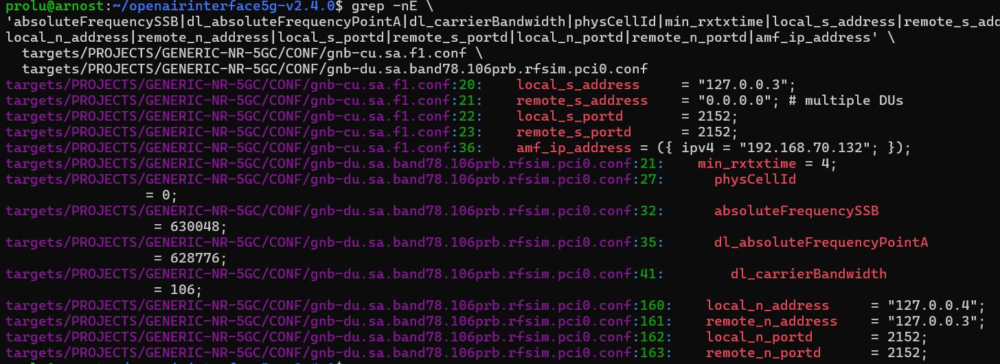
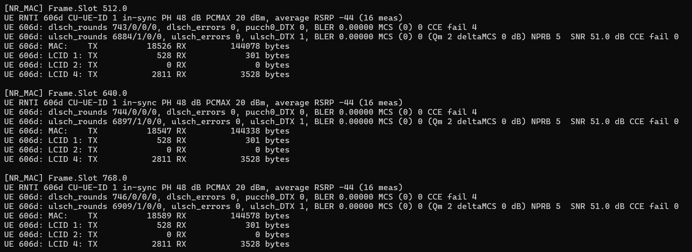

# Wireless Communications Lab3
###### tags: `Wireless Communications`

## :notebook_with_decorative_cover: Lab 4: 5G CU/DU Split Deployment and F1-C/F1-U Analysis

## 1. Lab Overview

After completing this lab, you should be able to:

- Explain the functional division between gNB-CU and gNB-DU.
- Deploy a split 5G SA RAN with OAI and RFsimulator.
- Identify F1-C control-plane messages (F1 Setup, RRC transfer, UE Context Setup).
- Identify F1-U user-plane GTP-U packets, including their direction and TEID.
- Verify UE IP connectivity through the split architecture.
- Distinguish F1-U from the separate N3 interface, even though both can use GTP-U.

## 2. Network architecture and experimental parameters

## 3. Task 1 — Inspect the split configurations

 

*Figure: Split configurations*

## Task 1 — Inspect the Split Configurations

| Parameter | Observed Value |
|---|---|
| CU F1 address | `127.0.0.3` |
| DU F1 address | `127.0.0.4` |
| DU SSB NR-ARFCN | `630048` |
| DL absolute Frequency Point A | `628776` |
| PRB count | `106` |
| Physical Cell ID | `0` |
| `min_rxtxtime` | `4` |
| F1-U UDP port | `2152` |
| AMF address | `192.168.70.132` |

### Questions

1. Which protocol layers mainly reside in the CU, and which reside in the DU?

   The gNB-CU has the higher layer functions (RRC and PDCP). The gNB-DU hhas RLC, MAC, PHY. This split allows to process separate the higher level control functions and low level radio processing.

2. What is the purpose of the F1 interface?

   The F1 interface is connecting the gNB-CU and gNB-DU. F1-C has the control plane signal using F1AP and F1-U has the user plane traffic using GTP-U. This is allowing for the CU and DU to coooperate together.

3. Why must the UE radio frequency be compatible with the DU rather than taken blindly from the previous lab?

   The UE has to tune to the radio carrier confiigured by the DU. The DU uses `630048`, corrresponding to the split-lab frequency.

## Task 2 — Split 5G SA Connectivity

| Measurement | Observed Value |
|---|---:|
| UE IP address | `10.0.0.2` |
| Destination IP | `192.168.70.135` |
| Packets transmitted | 30 |
| Packets received | 30 |
| Packet loss | 0% |
| Minimum RTT | 13.559 ms |
| Average RTT | 23.117 ms |
| Maximum RTT | 40.656 ms |

Evidence: Screenshots of CU/DU startup, UE connection, and successful Ping. Record the observed UE IP, transmitted/received packets, packet loss, and average RTT. Do not invent values; they vary by machine.

 

*Figure: CU Startup*

 

*Figure: DU Startup*

 

*Figure: UE connection*

 

*Figure: Successful ping*

