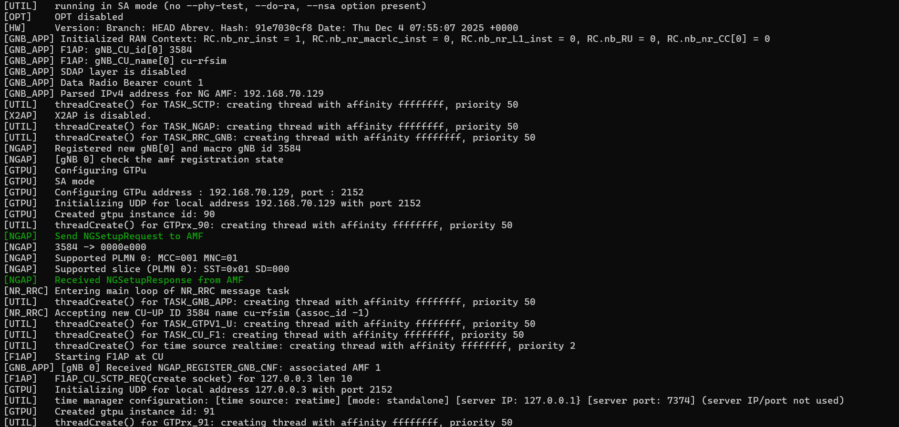
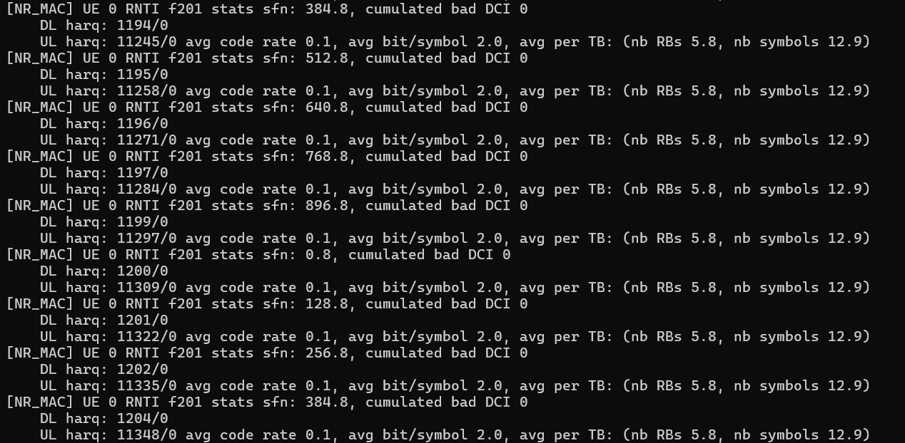
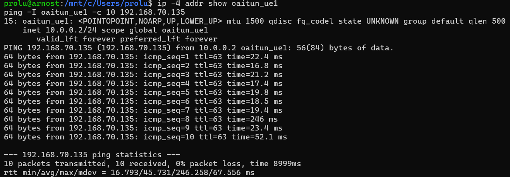

# Wireless Communications Lab3
###### tags: `Wireless Communications`

## :notebook_with_decorative_cover: Lab 4: 5G CU/DU Split Deployment and F1-C/F1-U Analysis

## 1. Lab Overview

After completing this lab, you should be able to:

- Explain the functional division between gNB-CU and gNB-DU.
- Deploy a split 5G SA RAN with OAI and RFsimulator.
- Identify F1-C control-plane messages (F1 Setup, RRC transfer, UE Context Setup).
- Identify F1-U user-plane GTP-U packets, including their direction and TEID.
- Verify UE IP connectivity through the split architecture.
- Distinguish F1-U from the separate N3 interface, even though both can use GTP-U.

## 2. Network architecture and experimental parameters

## 3. Task 1 — Inspect the split configurations

 

*Figure: Split configurations*

| Parameter | Observed Value |
|---|---|
| CU F1 address | `127.0.0.3` |
| DU F1 address | `127.0.0.4` |
| DU SSB NR-ARFCN | `630048` |
| DL absolute Frequency Point A | `628776` |
| PRB count | `106` |
| Physical Cell ID | `0` |
| `min_rxtxtime` | `4` |
| F1-U UDP port | `2152` |
| AMF address | `192.168.70.132` |

### Questions

1. Which protocol layers mainly reside in the CU, and which reside in the DU?

   The gNB-CU has the higher layer functions (RRC and PDCP). The gNB-DU hhas RLC, MAC, PHY. This split allows to process separate the higher level control functions and low level radio processing.

2. What is the purpose of the F1 interface?

   The F1 interface is connecting the gNB-CU and gNB-DU. F1-C has the control plane signal using F1AP and F1-U has the user plane traffic using GTP-U. This is allowing for the CU and DU to coooperate together.

3. Why must the UE radio frequency be compatible with the DU rather than taken blindly from the previous lab?

   The UE has to tune to the radio carrier confiigured by the DU. The DU uses `630048`, corrresponding to the split-lab frequency.

## 4. Task 2 — Split 5G SA Connectivity

| Measurement | Observed Value |
|---|---:|
| UE IP address | `10.0.0.2` |
| Destination IP | `192.168.70.135` |
| Packets transmitted | 30 |
| Packets received | 30 |
| Packet loss | 0% |
| Minimum RTT | 13.559 ms |
| Average RTT | 23.117 ms |
| Maximum RTT | 40.656 ms |

Evidence: Screenshots of CU/DU startup, UE connection, and successful Ping. Record the observed UE IP, transmitted/received packets, packet loss, and average RTT. Do not invent values; they vary by machine.

 

*Figure: CU Startup*

 

*Figure: DU Startup*

 

*Figure: UE connection*

 

*Figure: Successful ping*

## 5. Task 3 — Capture F1-C and F1-U in a single PCAP

A packet capture was performed on the Linux loopback interface between the CU address `127.0.0.3` and DU address `127.0.0.4`.

The capture has:

- F1-C: F1AP signaling carried over SCTP between the DU and CU.
- F1-U: GTP-U user-plane traffic carried over UDP between the DU and CU.

The capture file was saved as: `lab4-f1-complete.pcap`.  The capture was opened with wireshark on windows.

## 6. Task 4 — Analyze F1-C (F1AP / SCTP)

### F1 Setup Sequence

| Packet | Source | Destination | Message | Meaning |
|---:|---|---|---|---|
| 1 | `127.0.0.4` | `127.0.0.3` | SCTP INIT | DU starts the SCTP |
| 2 | `127.0.0.3` | `127.0.0.4` | SCTP INIT_ACK | CU acknowledges the SCTP request|
| 3 | `127.0.0.4` | `127.0.0.3` | SCTP COOKIE_ECHO | DU continues SCTP establish|
| 4 | `127.0.0.3` | `127.0.0.4` | SCTP COOKIE_ACK | SCTP association is establish|
| 5 | `127.0.0.4` | `127.0.0.3` | F1 Setup Request | DU initiates the F1 setup|
| 7 | `127.0.0.3` | `127.0.0.4` | F1 Setup Response | CU accepts the F1 Setup|
| 9 | `127.0.0.4` | `127.0.0.3` | GNBDUConfigurationUpdate | DU informs the CU configuration|
| 10 | `127.0.0.3` | `127.0.0.4` | GNBDUConfigurationUpdateAcknowledge | CU acknoledge the DU configuration|

### Questions

1. Which node initiates F1 Setup, and which acknowledges it?

   The gNB-DU starts the F1 Setup procedure by sending the F1 Setup Request to the gNB-CU. The packet 5 is sent from `127.0.0.4` (DU) to `127.0.0.3` (CU). The CU acknowlegdes the procedure by the F1 Setup Response.

2. Explain the difference between SCTP association establishment and F1 Setup.

   The SCTP association establishment makes the transport connection between the DU and CU. It uses the INIT, INIT_ACK, COOKIE_ECHO, COOKIE_ACK messages. F1 Setup occurs after SCTP is established.

3. How can a NAS Registration Request be transported over F1-C?

   The UE first sends the NAS Registration Request inside an RRC message toward the DU. The DU forwards the UE RRC signaling to the CU using an F1AP UL RRC Message.

4. What is the role of UE Context Setup?

   The UE Context Setup makes UE resources and context between the CU and DU. The CU sends a UE Context Request and the DU responds after creating the required UE resources.

5. Does F1 Setup alone prove successful UE Registration? Explain.

   No, it does not, because the F1 Setup only proves that the CU and DU established their internal F1 interface successfully. The UE must still synchronize, complete RRC procedures, so F1 Setup can succeed even if UE Registration later fails.

 

*Figure: F1 Setup Request/Response*

