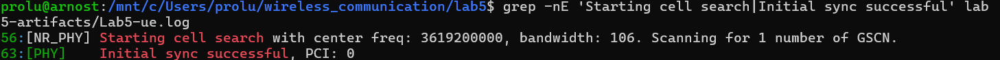
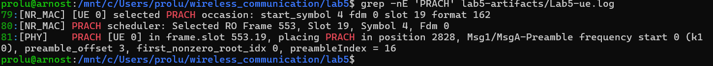
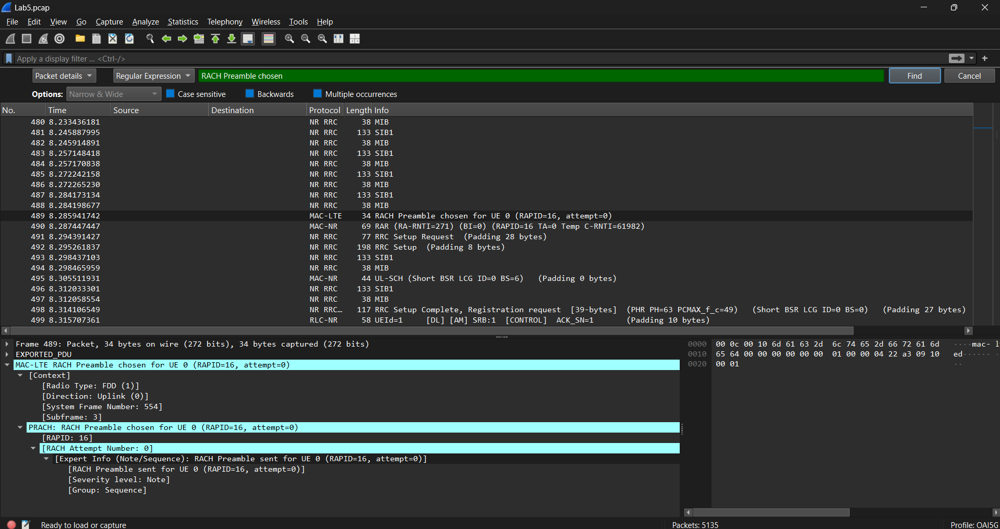

# Wireless Communications Lab5
###### tags: `Wireless Communications`

## :notebook_with_decorative_cover: Lab 5: From Initial Access to RRC Connection Setup

## 1. Lab Goal
In Lab 1, you observed UE registration with the 5GC and the establishment of data service. This lab moves the observation point earlier: before registering with the Core network, how does a UE find a gNB, obtain cell system information, perform Random Access, and finally establish an RRC connection?

The main procedure in this lab is:

Cell search / initial synchronization
- MIB / SIB1
- Msg1 PRACH
- Msg2 RAR
- Msg3 RRCSetupRequest
- Msg4 RRCSetup
- RRCSetupComplete
- RRC_CONNECTED

This lab ends at RRC_CONNECTED. NAS Registration, Authentication, and PDU Session establishment belong to the Core network scope covered in Lab 1.

Trace a successful NR Initial Access procedure from cell search to RRC_CONNECTED.
Use UE logs and Wireshark MAC-NR PCAP to identify MIB/SIB1, 4-step Random Access, and RRC setup messages.
Reconstruct the UE–gNB message sequence and distinguish RAN access from 5GC registration.

## 2. Evidence Used in This Lab

- Requirement and Rule

Use the provided log and pcap as the primary evidence.
Submit the required screenshots, extracted values, and brief explanations for each task.
Task 3 must be an original UE–gNB MSC diagram based on your own observations.

You will receive three files produced by the same successful OAI run:

- Lab5-ue.log
- Lab5-gnb.log
- Lab5.pcap

## 3. Learning Objectives

After completing this lab, you should be able to:

- Explain the UE procedure from Cell Search to RRC_CONNECTED in the correct order.
- Distinguish the roles of broadcast system information, Random Access, and RRC Connection Setup.
- Obtain complementary evidence from a UE log and a Wireshark MAC-NR trace.
- Explain the meaning of RRC_CONNECTED and how it differs from 5GC Registration.

## 4. Open the Supplied Files

Perform all analysis from the openairinterface5g repository root. Put the three supplied files in lab5-artifacts/, or in another location of your choice. If you use another location, adjust the paths in the commands accordingly.

- lab5-artifacts/Lab5-ue.log
- lab5-artifacts/Lab5-gnb.log
- lab5-artifacts/Lab5.pcap
- Open lab5-artifacts/Lab5.pcap in Wireshark.

If Wireshark shows only UDP packets or the nr-rrc filter does not work, complete the following setup once:

- Open Analyze → Enabled Protocols..., search for, and enable MAC-NR-FRAMED.
- Open Preferences → Protocols → MAC-NR and enable NR RRC decoding for BCCH/CCCH data.
- Open Preferences → Protocols → RLC-NR and enable RRC decoding for CCCH data and AM reassembly.
- Close and reopen the PCAP.

## 5. Submission and Grading

Add a brief explanation below every screenshot. You do not need to draw boxes or arrows on screenshots.

## Task 1: From Cell Search to Msg2 RAR - 35 points

### Step 1: Find Cell Search and Initial Synchronization — 8 points

Run the following command on Lab5-ue.log:

grep -nE 'Starting cell search|Initial sync successful' lab5-artifacts/Lab5-ue.log
Record whether UE synchronization succeeded and the PCI value. Explain: after completing initial synchronization, what is the UE able to do?

 

*Figure: Cell search*

This observation shows that:

- UE synchronization succeeded: Yes
- PCI: 0
- Cell search log line: 56
- Initial synchronization success log line: 63

The UE completed initial synchronization with the NR cell (Initial sync successful), PCI: 0. After synchronization, the UE is aligned with the gNB in time and frequency and knows the physical cell identity.

### Step 2: Find MIB and SIB1 — 8 points

 

*Figure: MIB and SIB1*

The SIB1 is frame number 1. The MIB is frame number 2.

It shows that both MIB and SIB1 are repeatedly and separately broadcasted by the gNB and the MIB provides basic cell information needed for the UE to continue decoding the cell and the SIB1 gives common system information and access configuration.

### Step 3: Find Msg1 PRACH — 8 points

 

*Figure: Msg1 PRACH*

- frame.slot: `553.19`
- preambleIndex: `16`

The PRACH transmission is the Msg1 of the 4 step random access taskk. The UE transmitted PRACH at frame.slot `553.19` using preamble index `16`. This is the PRACH preamble and it is the UE's initial random access transmission to gNB.

 

*Figure: RACH Preamble chosen*

