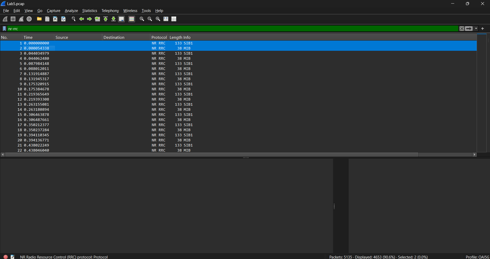
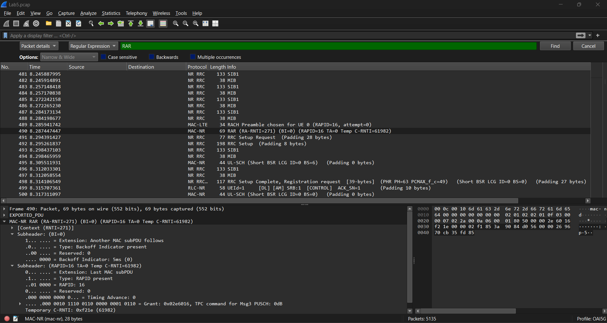
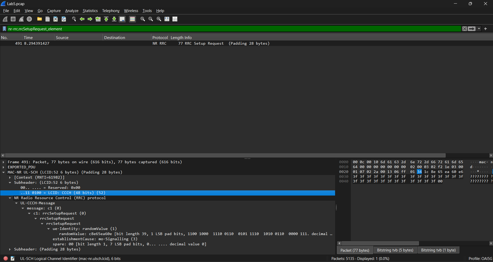
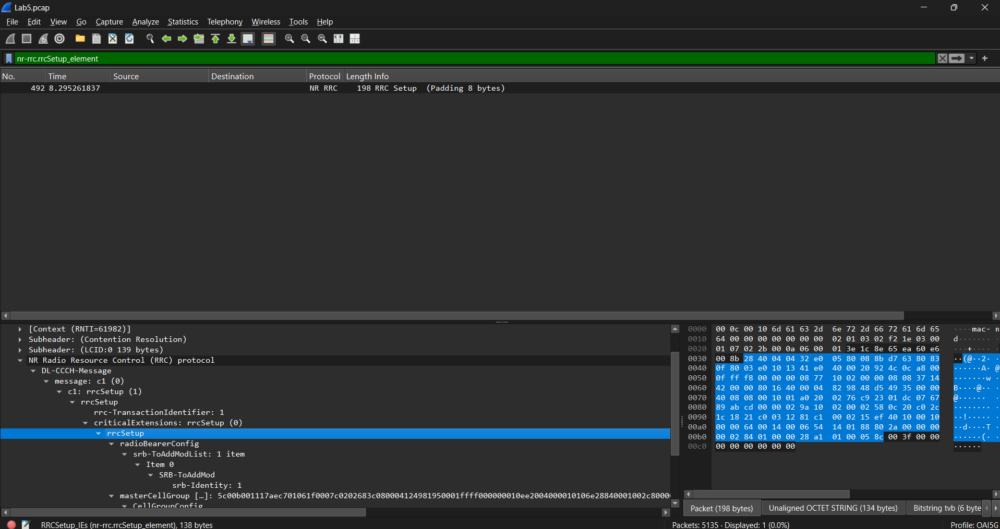
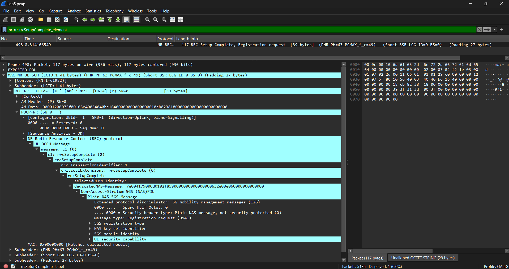
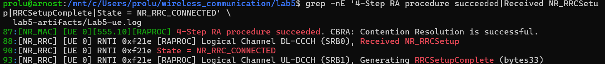
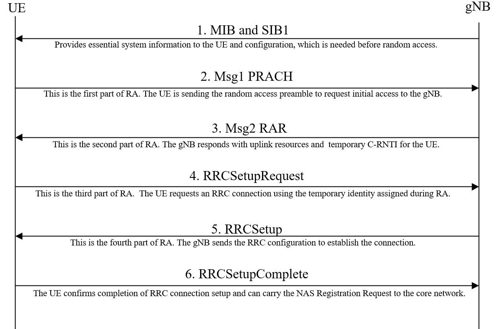

# Wireless Communications Lab5
###### tags: `Wireless Communications`

## :notebook_with_decorative_cover: Lab 5: From Initial Access to RRC Connection Setup

## 1. Lab Goal
In Lab 1, you observed UE registration with the 5GC and the establishment of data service. This lab moves the observation point earlier: before registering with the Core network, how does a UE find a gNB, obtain cell system information, perform Random Access, and finally establish an RRC connection?

The main procedure in this lab is:

Cell search / initial synchronization
- MIB / SIB1
- Msg1 PRACH
- Msg2 RAR
- Msg3 RRCSetupRequest
- Msg4 RRCSetup
- RRCSetupComplete
- RRC_CONNECTED

This lab ends at RRC_CONNECTED. NAS Registration, Authentication, and PDU Session establishment belong to the Core network scope covered in Lab 1.

Trace a successful NR Initial Access procedure from cell search to RRC_CONNECTED.
Use UE logs and Wireshark MAC-NR PCAP to identify MIB/SIB1, 4-step Random Access, and RRC setup messages.
Reconstruct the UE–gNB message sequence and distinguish RAN access from 5GC registration.

## 2. Evidence Used in This Lab

- Requirement and Rule

Use the provided log and pcap as the primary evidence.
Submit the required screenshots, extracted values, and brief explanations for each task.
Task 3 must be an original UE–gNB MSC diagram based on your own observations.

You will receive three files produced by the same successful OAI run:

- Lab5-ue.log
- Lab5-gnb.log
- Lab5.pcap

## 3. Learning Objectives

After completing this lab, you should be able to:

- Explain the UE procedure from Cell Search to RRC_CONNECTED in the correct order.
- Distinguish the roles of broadcast system information, Random Access, and RRC Connection Setup.
- Obtain complementary evidence from a UE log and a Wireshark MAC-NR trace.
- Explain the meaning of RRC_CONNECTED and how it differs from 5GC Registration.

## 4. Open the Supplied Files

Perform all analysis from the openairinterface5g repository root. Put the three supplied files in lab5-artifacts/, or in another location of your choice. If you use another location, adjust the paths in the commands accordingly.

- lab5-artifacts/Lab5-ue.log
- lab5-artifacts/Lab5-gnb.log
- lab5-artifacts/Lab5.pcap
- Open lab5-artifacts/Lab5.pcap in Wireshark.

If Wireshark shows only UDP packets or the nr-rrc filter does not work, complete the following setup once:

- Open Analyze → Enabled Protocols..., search for, and enable MAC-NR-FRAMED.
- Open Preferences → Protocols → MAC-NR and enable NR RRC decoding for BCCH/CCCH data.
- Open Preferences → Protocols → RLC-NR and enable RRC decoding for CCCH data and AM reassembly.
- Close and reopen the PCAP.

## 5. Submission and Grading

Add a brief explanation below every screenshot. You do not need to draw boxes or arrows on screenshots.

## Task 1: From Cell Search to Msg2 RAR - 35 points

### Step 1: Find Cell Search and Initial Synchronization — 8 points

Run the following command on Lab5-ue.log:

grep -nE 'Starting cell search|Initial sync successful' lab5-artifacts/Lab5-ue.log
Record whether UE synchronization succeeded and the PCI value. Explain: after completing initial synchronization, what is the UE able to do?

 

*Figure: Cell search*

This observation shows that:

- UE synchronization succeeded: Yes
- PCI: 0
- Cell search log line: 56
- Initial synchronization success log line: 63

The UE completed initial synchronization with the NR cell (Initial sync successful), PCI: 0. After synchronization, the UE is aligned with the gNB in time and frequency and knows the physical cell identity.

### Step 2: Find MIB and SIB1 — 8 points

 

*Figure: MIB and SIB1*

The SIB1 is frame number 1. The MIB is frame number 2.

It shows that both MIB and SIB1 are repeatedly and separately broadcasted by the gNB and the MIB provides basic cell information needed for the UE to continue decoding the cell and the SIB1 gives common system information and access configuration.

### Step 3: Find Msg1 PRACH — 8 points

 

*Figure: Msg1 PRACH*

- frame.slot = `553.19`
- preambleIndex = `16`

The PRACH transmission is the Msg1 of the 4 step random access taskk. The UE transmitted PRACH at frame.slot `553.19` using preamble index `16`. This is the PRACH preamble and it is the UE's initial random access transmission to gNB.

 

*Figure: RACH Preamble chosen*

- RAPID = `16`

This UE log shows that the PRACH was transmitted at frame.slot `553.19` using preamble index `16`.

1. Which Random Access message is this PRACH transmission?

This PRACH transmission is Msg1 of the 4 step random access procedure.

2. At which `frame.slot` and with which `preambleIndex` does the UE log show transmission?

The UE log shows the PRACH transmission at frame.slot `553.19` with `preambleIndex = 16`.

3. Does the Wireshark `RAPID` match the UE-log `preambleIndex`? What does this show?

Yes, it does. It shows that in Wireshark also shows `RAPID = 16`, which is the same as the UE-log `preambleIndex = 16`. This means that the PRACH preamble transmitted by the UE is the same random access preamble seen by the gNB.

### Step 4: Find Msg2 RAR in Wireshark — 11 points

 

*Figure: Msg2 RAR*

- RAPID = `16`
- Temporary C-RNTI = `61982`
- Frame number = `490`

This packet is Msg2, which is the Random Access Response (RAR) in the 4 step random access procedure. The gNB responds to the PRACH preamble of the UE and gives the UE with temporary C-RNTI.

## Task 2: Complete Random Access and RRC Connection Setup — 40 points

Complete the following steps in order. For each message, provide a screenshot and record the requested frame number, fields, and brief explanation.

### Step 1: Find RRCSetupRequest — 10 points

 

*Figure: RRCSetupRequest*

Frame number = `491`
Context RNTI = `61982`

Briefly answer:

- Does the Context RNTI match the Temporary C-RNTI in the Task 1 / Step 4 RAR? What does this show?

Yes, it does. It shows the context RNTI is `61982`, which is matches the temporary C-RNTI `61982` , which is assigned in the Msg2 RAR. This shows that the the RRCSetupRequest is connected with the same UE that received the RAR and that the temporary UE identity is being used for the access procedure.

- Can you claim that the RRC connection has been established after seeing only RRCSetupRequest? Why or why not?

No, I can not, because the RRCSetupRequest is only the UE request to make a RRC connection. The gNB must still send `RRCSetup` and the UE must then respond with `RRCSetupComplete`.

### Step 2: Find RRCSetup — 10 points

 

*Figure: RRCSetup*

Frame number = `492`
Context RNTI = `61982`
rrc-TransactionIdentifier = `1`
Check whether Contention Resolution also appears in the packet. Yes, it appear.

Below the screenshot, briefly answer:

- Which message is this in four-step Random Access?

This downlink transmission corresponds to `Msg4`, it has the contention resolution information and the `RRCSetup` message from the gNB to the UE.

- What does it mean that Contention Resolution and RRCSetup appear in the same downlink message?

It means that the gNB resolves the random access contention it provides the UE with the RRC configuration needed to continue connection establishment. The UE can confirm that the access attempt was accepted and proceed to completing the RRC connection.

### Step 3: Find RRCSetupComplete — 12 points

 

*Figure: RRCSetupComplete*

Select the packet and first verify that MAC-NR UL-SCH appears at the top. Expand:

RLC-NR → PDCP-NR → NR Radio Resource Control (RRC) protocol
  → UL-DCCH-Message → message: c1
Expand message: c1 further and confirm that it contains rrcSetupComplete. Record:

Frame number = `498`
Context RNTI = `61982`
rrc-TransactionIdentifier = `1`

It contains the rrcSetupComplete.

Below the screenshot, briefly answer:

- Does the Context RNTI still match the Temporary C-RNTI in the RAR?

Yes, it does. The context of RNTI is `61982`, which is the same as the Temporary C-RNTI assigned in the Msg2 RAR previously, so this confirms that the same UE context continues through the random access.

- Does the rrc-TransactionIdentifier match the RRCSetup in Step 2? What is the purpose of this comparison?

Yes, it does, because both the `RRCSetup` and `RRCSetupComplete` are using `rrc-TransactionIdentifier = 1`, so matching the transaction identifier shows that the RRCSetupComplete is the UE response to the specific RRCSetup transaction sent by the gNB.

### Step 4: Confirm the Final Random Access and RRC Connection Result — 8 points

 

*Figure: Final Random Access and RRC Connection Result*

Run the following command on the UE log:

grep -nE '4-Step RA procedure succeeded|Received NR_RRCSetup|RRCSetupComplete|State = NR_RRC_CONNECTED' \
  lab5-artifacts/Lab5-ue.log

From the output, record:

4-Step RA procedure succeeded: line `87`
Received NR_RRCSetup: line `88`
State = NR_RRC_CONNECTED: line `90`
Generating RRCSetupComplete: line `93`
Submit a screenshot of this log output and briefly answer:

- In log order, what are the three events from successful Random Access to generating RRCSetupComplete?

Thefirst thing UE reports `4-Step RA procedure succeeded` at line 87, which is meaning the contention based random access procedure completed successfully. As a second thing the UE receives `NR_RRCSetup` at line 88 and enters `NR_RRC_CONNECTED` state at line 90. As third thing the UE generates `RRCSetupComplete` at line 93.

- What do 4-Step RA procedure succeeded and State = NR_RRC_CONNECTED each prove?

The 4-Step RA procedure succeeded proves that the random access procedure, completed successfully. The State = NR_RRC_CONNECTED proves that the UE has progressed into the RRC connected state after receiving and processing the RRCSetup request. Thesse two messages confirm two different stages: successful radio access first and then successful RRC connection establishment.

## Task 3: Draw an Initial Access MSC Diagram — 25 points

Using the log and Wireshark evidence found in Tasks 1 and 2, draw your own Message Sequence Chart (MSC). It must include two vertical lifelines, UE and gNB, and the following six messages: MIB/SIB1, Msg1, Msg2, Msg3, Msg4, and RRCSetupComplete.

Determine and draw the correct order and direction of the messages yourself. Add a one-sentence purpose next to each arrow.

 

*Figure: Initial Access MSC Diagrame*

   
